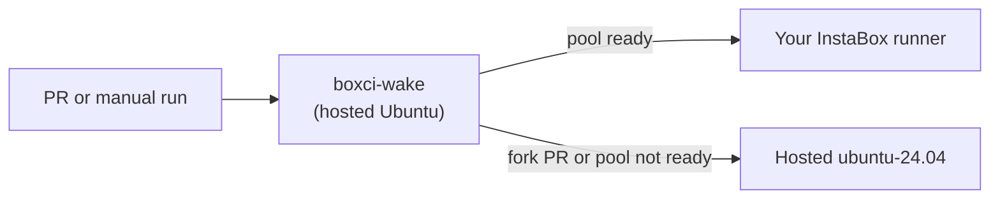

<div align="center">

# BoxCI

**GitHub Actions runners on your own InstaBox VMs.<br>They wake up for CI and pause again when idle.**

[](LICENSE)
[](package.json)
[](https://www.npmjs.com/package/@balasivagn/boxci)
[](#contributing)

[Quick start](#quick-start) · [Agent setup](#set-up-with-a-coding-agent) · [How it works](#how-it-works) · [Commands](#commands) · [Migrate jobs](#move-existing-jobs-onto-the-pool) · [Agent skill](#let-your-coding-agent-do-the-migration) · [Good to know](#good-to-know) · [Docs](#docs)

</div>

---

More pull requests mean more CI runs. Coding agents now open them too, and every one still needs builds and tests before anyone can trust it.

Hosted minutes run out. A spare machine as a runner turns into a queue the moment a few people push at once.

**BoxCI turns InstaBox VMs into dedicated GitHub Actions runners for your repository.** One command plans the setup, one PR wires up the workflow, and your jobs run on machines you control.

**Already have CI?** `boxci migrate` moves your existing jobs onto the pool, Blacksmith or `ubuntu-latest` alike, as a local diff you review. It ships with an agent skill, so your coding agent can do the migration with you.

## How it works in 3 steps

|       | Step                    | What happens                                                                                                                                                               |
| :---: | ----------------------- | -------------------------------------------------------------------------------------------------------------------------------------------------------------------------- |
| **1** | **`boxci init`**        | Reuses your GitHub and InstaBox sign-ins, shows the full plan, then creates a dedicated VM and registers it as a runner. No cloud resources are created until you approve. |
| **2** | **Merge the PR**        | Setup ends in a normal workflow PR. You review it and merge it through your usual process. BoxCI never merges for you.                                                     |
| **3** | **Jobs run on your VM** | A small hosted job wakes the pool for each trusted run, and GitHub hands the build to your runner. Between builds, the VMs pause as usual.                                 |

## Why BoxCI

- **Bring your existing CI.** `boxci migrate` retargets the jobs you already have (Blacksmith `runs-on` labels, for example) in one command, as a local diff you review and commit.
- **Agent-ready.** The bundled [`boxci-migrate` skill](skills/boxci-migrate/SKILL.md) teaches your coding agent to drive `boxci migrate` instead of hand-editing YAML.
- **Reviewable from start to finish.** A dry run shows exactly what will be created. The real run ends in a PR, not a surprise.
- **Nothing extra to keep running.** No keepalive, no webhook server, no BoxCI account. The wake step lives inside GitHub Actions.
- **Close your laptop after setup.** CI wakes the pool on its own. The CLI and dashboard are only for you.
- **A dashboard that watches without touching.** `boxci dashboard` is local, authenticated and read-only. It never wakes a VM.
- **Hosted fallback built in.** Fork PRs, or a pool that is not fully ready, run on hosted Ubuntu instead. Fork code never receives your provider key.

## Set up with a coding agent

Open your app's checkout in any coding agent with terminal access and paste:

```text
Set up BoxCI in this repo using https://github.com/balasivagn/boxci. Install its CLI with `npm install -g @balasivagn/boxci`, reuse my current GitHub/InstaBox sign-ins, and show me `boxci init --dry-run` for approval before applying. Then complete setup, migrate compatible existing Linux x64 CI jobs with `boxci migrate`, preserve existing pools, verify with `boxci doctor` and `boxci status`, and leave workflow changes in a PR for review.
```

Your agent handles the commands; you complete any official browser sign-in and approve the setup plan.

## Quick start

You need Node.js 22+, Git, admin access to a GitHub repository, and an InstaBox account with room for one more VM. See [full requirements](#requirements).

**1. Install the CLI:**

```sh
npm install -g @balasivagn/boxci
boxci --help
```

**2. Preview, then set up,** from your app's checkout:

```sh
cd /path/to/your-app
boxci init --dry-run
boxci init
```

The dry run shows the account, repository, runner label, test command and every planned action. It creates no VMs, runners, keys or repository settings. `boxci init` asks you to approve that plan, then provisions the VM and opens a workflow PR.

**3. Review and merge the PR, then run CI:**

Check the generated test command, Node version and triggers before you merge. The setup PR itself can already run CI.

```sh
boxci ci run
```

Open the **BoxCI** run in GitHub Actions and watch your first job land on your own runner. `boxci status` shows the pool and recent jobs.

<details>
<summary><b>Install tips:</b> PATH, updating, installing from main, custom test commands</summary>

<br>

- **`boxci: command not found`?** Put npm's global bin directory on `PATH`, or install into a user-owned prefix:

  ```sh
  npm install -g --prefix "$HOME/.local" @balasivagn/boxci
  export PATH="$HOME/.local/bin:$PATH"
  ```

- **Update:** run the same install command again.
- **Install from source (`main`):** to try unreleased changes, install the current `main` snapshot straight from GitHub:

  ```sh
  npm install -g https://github.com/balasivagn/boxci/archive/refs/heads/main.tar.gz
  ```

  To pin a reviewed snapshot, replace `refs/heads/main` in the URL with a commit SHA.

- **Choose the repository explicitly:** add `--repo owner/repository`.
- **Override the inferred test command:** pass the same command to the preview and the real run.

  ```sh
  boxci init --command "npm ci && npm run test:ci" --dry-run
  boxci init --command "npm ci && npm run test:ci"
  ```

- **Interrupted?** Rerun `boxci init`. It resumes from saved checkpoints.
- **Reusing an existing pool?** Start with a dry run and read [pool discovery and recovery](docs/CONFIGURATION.md#pool-discovery-and-recovery), especially on a new machine.

</details>

## How it works


1. **Wake.** A hosted Ubuntu job reads the pool variable and CI secret. For a trusted event it wakes every pool VM at once and checks their runner services. This privileged step never checks out PR code.
2. **Route.** If the whole pool is ready, the build targets your dedicated self-hosted label. Otherwise, and always for fork PRs, it falls back to hosted `ubuntu-24.04`.
3. **Run.** GitHub assigns the build to an idle runner with matching labels. Afterwards the VMs keep InstaBox's normal idle suspension.



Go deeper: [architecture and source map](docs/ARCHITECTURE.md) · [interactive diagram](docs/architecture/boxci.html) (download and open locally)

## Commands

| Command                       | What it does                                                 |
| ----------------------------- | ------------------------------------------------------------ |
| `boxci init`                  | Plan and set up runners, secret, pool variable, workflow PR  |
| `boxci init --dry-run`        | Preview setup without creating anything                      |
| `boxci ci run`                | Dispatch the BoxCI workflow on the default branch            |
| `boxci ci run --ref <branch>` | Dispatch on an explicit ref                                  |
| `boxci status`                | VM and runner states plus recent jobs (passive)              |
| `boxci doctor`                | Check account, quota, mapping, merge state, key expiry       |
| `boxci dashboard`             | Local, read-only live view (`--no-open` to skip the browser) |
| `boxci wake`                  | Explicitly wake the pool                                     |
| `boxci pool add --count 1`    | Add a VM to the pool, within your quota                      |
| `boxci auth renew`            | Rotate the 30-day CI credential                              |
| `boxci migrate`               | Move existing workflow jobs onto the pool                    |

Common flags: `--dry-run` previews any change, `--yes` applies a reviewed plan without a prompt, `--json` returns structured output, and `--repo owner/repository` works outside the checkout. `status`, `doctor` and `dashboard` never run guest commands or wake VMs.

## Move existing jobs onto the pool

Already have CI? After `boxci init`, run this from the target repository's checkout:

```sh
boxci migrate --match blacksmith --dry-run
boxci migrate --match blacksmith
```

Or run `boxci migrate` with no flags to pick jobs interactively. Prefer explicit jobs? Use `--jobs file.yml:job,...`. To do it in one go, `boxci init --migrate-workflows` runs the same migration right after setup.

Migration adds a hosted `boxci-wake` job and points the selected jobs at the pool:

```yaml
needs: boxci-wake
runs-on: ${{ fromJSON(needs.boxci-wake.outputs.runner) }}
```

It edits files locally and pushes nothing. Review `git diff`, then commit and open a PR yourself.

### Let your coding agent do the migration

BoxCI ships an agent skill at [`skills/boxci-migrate/SKILL.md`](skills/boxci-migrate/SKILL.md), included in the npm package too. Point your coding agent at it and ask in plain words, for example "move our Blacksmith test jobs onto BoxCI". The skill tells the agent to map your request to `boxci migrate --match` or `--jobs`, let you approve the plan, and leave the diff for your review rather than hand-editing workflow files. Migration itself is deterministic and needs no model.

<details>
<summary>What migration does and does not change</summary>

<br>

- `--match` is a regular expression tested against each job's existing `runs-on` value.
- Pick jobs that run on **Linux x64** and whose steps work on both the InstaBox VM and the hosted Ubuntu fallback.
- Migration changes scheduling only. Toolchains, services and caches stay as they are.
- Only static `runs-on` values are scanned. Dynamic expressions are skipped. Review matrix jobs and complex `needs` by hand.
- The starter workflow is separate and is skipped by migration. If your existing CI already runs the same tests, decide whether to keep the starter enabled to avoid duplicate builds.

</details>

## Good to know

BoxCI is a young project and it tries to be precise about what it does. The details below matter, so they are collected here rather than scattered through the page.

<a id="requirements"></a>

<details>
<summary><b>Requirements</b></summary>

<br>

- Node.js **22 or newer**, npm, Git and access to GitHub.
- A GitHub.com repository where you have **admin access**, with Actions enabled.
- An InstaBox account with capacity for at least one additional VM, or an existing verified CI pool. Paused or stopped VMs still count toward quota.
- A terminal for the official GitHub and InstaBox sign-in flows. Existing sessions are reused. BoxCI bundles the official InstaBox CLI as a fallback and can install a checksum-verified GitHub CLI privately when it is missing.
- **Use a dedicated InstaBox account for CI if you can.** The CI key can execute commands on every VM in its account.

</details>

<details>
<summary><b>What the starter workflow covers</b></summary>

<br>

- **Linux x64** runners, **Node 24** and **one build job**.
- The test command is inferred for npm or pnpm from `package.json` on the target repository's **default branch**. Use `--command` for anything else. Other language toolchains need explicit workflow setup.
- Triggers: non-draft PRs and manual dispatch. There is **no `push` trigger**. Draft PRs skip the wake and build jobs.
- Fork PRs always use hosted Ubuntu.

</details>

<details>
<summary><b>How much capacity do I get?</b></summary>

<br>

One runner handles one job at a time. A pool can hold up to five distinct VMs, subject to your actual account quota, and a single VM is a complete setup. To use several VMs in parallel you need multiple jobs or a matrix; adding VMs does not split one job. BoxCI never deletes another VM to free quota.

</details>

<details>
<summary><b>Will it save money or make builds faster?</b></summary>

<br>

BoxCI makes no cost or speed promises. It does not charge a runner-minute fee, but InstaBox usage, the hosted wake and fallback jobs, and any other services follow their own billing, and BoxCI enforces no spending cap. Measure your own build times and provider usage. If you do not need your own VMs, hosted GitHub runners remain the simpler choice. Check current provider terms in the InstaBox [limits](https://instabox.sh/docs/limits) and [changelog](https://instabox.sh/changelog).

</details>

<details>
<summary><b>The CI credential expires every 30 days</b></summary>

<br>

Setup installs a validated 30-day provider key as an Actions secret. `boxci doctor` flags a known expiry within seven days. There is **no automatic renewal or reminder**, so schedule your own:

```sh
boxci auth renew --dry-run
boxci auth renew
```

If the key expires, the wake job falls back to hosted Ubuntu until you renew. See [renewing the CI credential](docs/OPERATIONS.md#renew-the-ci-credential).

</details>

<details>
<summary><b>A job stays queued after wake</b></summary>

<br>

Runner service readiness does not prove GitHub connectivity. Fallback is chosen before GitHub assigns the job, so it cannot rescue a job already queued on a disconnected self-hosted runner. See [troubleshooting a queued job](docs/OPERATIONS.md#a-job-stays-queued-after-wake).

</details>

<details>
<summary><b>Project status and what is verified</b></summary>

<br>

- BoxCI is at **v0.1.0**, an early release. The npm package is [`@balasivagn/boxci`](https://www.npmjs.com/package/@balasivagn/boxci).
- Commands in this README use a POSIX shell. Native Linux and Windows bootstrap and fresh-account authentication still need verification. Details are in [validation coverage](docs/VALIDATION.md).
- There is no automatic uninstall. Cleanup steps are in [stop using BoxCI](docs/OPERATIONS.md#stop-using-boxci).

</details>

<details>
<summary><b>Affiliation</b></summary>

<br>

BoxCI is an independent open-source integration. It is not built or endorsed by InstaBox, and it is **not affiliated with [boxci.dev](https://boxci.dev)**.

</details>

## Docs

| Guide                                            | Read it for                                                          |
| ------------------------------------------------ | -------------------------------------------------------------------- |
| [Configuration](docs/CONFIGURATION.md)           | Sign-in, local project records, repository settings, pool discovery  |
| [Operations](docs/OPERATIONS.md)                 | Status, renewal, adding capacity, recovery, troubleshooting, cleanup |
| [Architecture](docs/ARCHITECTURE.md)             | Setup, CI and monitoring paths, with a source map                    |
| [Validation](docs/VALIDATION.md)                 | What is tested today and what still needs verification               |
| [Releasing](docs/RELEASING.md)                   | npm trusted publishing and reviewed GitHub releases                  |
| [Security](SECURITY.md)                          | Credential scope and isolation limits                                |
| [Migration skill](skills/boxci-migrate/SKILL.md) | Agent-assisted workflow migration                                    |

## Contributing

Issues and PRs are welcome. The test suites need no live credentials.

```sh
git clone https://github.com/balasivagn/boxci.git
cd boxci
npm ci
npm test
python3 -m unittest discover -s ci/tests
npm run check
npm pack --dry-run
```

<details>
<summary>Notes for contributors</summary>

<br>

- Tests use injected transports and local HTTP fixtures. The Node tests need permission to bind loopback sockets.
- Keep live inventory, logs and scratch files in the ignored `.orca-scratch/` directory.
- `ci/wake.py` and `vendor/install.sh` are security-sensitive. Changes there need matching Python tests. See [AGENTS.md](AGENTS.md).
- To try a packed build locally:

  ```sh
  mkdir -p dist
  npm run pack:local
  npm install --global ./dist/balasivagn-boxci-0.1.0.tgz
  ```

- More: [developer experience contract](docs/DEVELOPER_EXPERIENCE.md) · [design tokens](docs/DESIGN.md)

</details>

## License

[Apache-2.0](LICENSE). Third-party notices are in [NOTICE](NOTICE) and `vendor/`. Official provider tools and vendored fonts keep their own licenses.

---

<div align="center">

Made by [Bala](https://github.com/balasivagn).<br>
If BoxCI helps your team, a star or an issue with what you learned means a lot.

</div>
