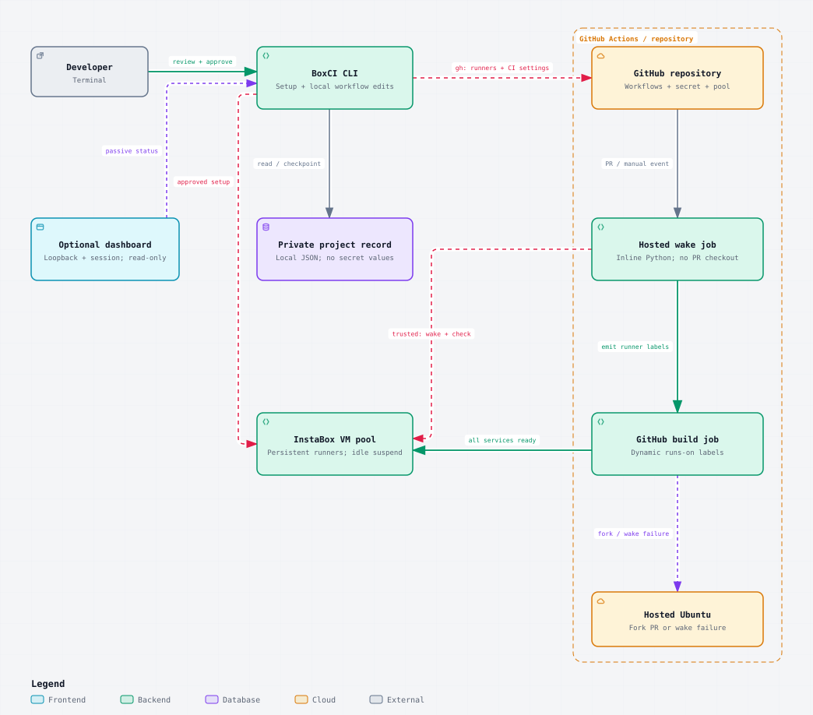

<div align="center">

# BoxCI

**GitHub Actions runners on your own InstaBox VMs.<br>They wake for CI and pause when idle.**

[](LICENSE)
[](package.json)
[](https://www.npmjs.com/package/@balasivagn/boxci)

[Quick start](#quick-start) · [How it works](#how-it-works) · [Commands](#commands) · [Migrate jobs](#migrate-existing-jobs) · [Limits](#limits) · [Docs](#docs)

</div>

---

`boxci init` creates a dedicated InstaBox VM, registers it as a runner for your repository and opens a workflow PR. After you merge, CI wakes the VM per run and GitHub hands the job to it. No keepalive, no webhook server, no BoxCI account.

- **Reviewable.** `--dry-run` shows the full plan first. Setup ends in a PR you merge yourself.
- **Safe fallback.** Fork PRs, or a pool that isn't ready, run on hosted `ubuntu-24.04`. Fork code never sees your provider key.
- **Read-only dashboard.** `boxci dashboard` is local and authenticated, and never wakes a VM.
- **Migrates existing CI.** `boxci migrate` retargets jobs (Blacksmith, `ubuntu-latest`) as a local diff. A bundled [agent skill](skills/boxci-migrate/SKILL.md) can drive it for you.

## Quick start

Needs Node.js 22+, Git, admin on a GitHub repo, and an InstaBox account with room for one more VM.

```sh
npm install -g @balasivagn/boxci

cd /path/to/your-app
boxci init --dry-run   # preview, creates nothing
boxci init             # approve the plan, get a workflow PR
```

Check the generated test command, Node version and triggers, merge the PR, then:

```sh
boxci ci run
boxci status
```

<details>
<summary>Install tips</summary>

<br>

- **`boxci: command not found`:** put npm's global bin on `PATH`, or install to a user prefix:

  ```sh
  npm install -g --prefix "$HOME/.local" @balasivagn/boxci
  export PATH="$HOME/.local/bin:$PATH"
  ```

- **Update:** rerun the install command.
- **Unreleased `main`:** `npm install -g https://github.com/balasivagn/boxci/archive/refs/heads/main.tar.gz` (swap `refs/heads/main` for a commit SHA to pin).
- **Pick the repo:** `--repo owner/repository`.
- **Custom test command:** pass the same `--command "npm ci && npm run test:ci"` to the dry run and the real run.
- **Interrupted?** Rerun `boxci init`. It resumes from checkpoints.
- **Existing pool?** Dry run first, and read [pool discovery and recovery](docs/CONFIGURATION.md#pool-discovery-and-recovery).

</details>

## How it works



1. **Wake.** A hosted Ubuntu job wakes every pool VM for trusted events and checks their runner services. It never checks out PR code.
2. **Route.** Pool ready: the build targets your dedicated self-hosted label. Otherwise, and always for fork PRs, it uses hosted `ubuntu-24.04`.
3. **Run.** GitHub assigns the build to an idle runner. Afterwards the VMs follow InstaBox's normal idle suspension.

More: [architecture and source map](docs/ARCHITECTURE.md) · [interactive diagram](docs/architecture/boxci.html) (download and open locally)

## Commands

| Command                    | What it does                                           |
| -------------------------- | ------------------------------------------------------ |
| `boxci init`               | Set up runner, secret, pool variable and workflow PR   |
| `boxci ci run`             | Dispatch the BoxCI workflow (`--ref <branch>` to pick) |
| `boxci status`             | VM and runner states, recent jobs (passive)            |
| `boxci doctor`             | Check account, quota, mapping, merge state, key expiry |
| `boxci dashboard`          | Local read-only live view (`--no-open` skips browser)  |
| `boxci wake`               | Explicitly wake the pool                               |
| `boxci pool add --count 1` | Add a VM, within your quota                            |
| `boxci auth renew`         | Rotate the 30-day CI credential                        |
| `boxci migrate`            | Move existing workflow jobs onto the pool              |

Flags: `--dry-run` previews any change, `--yes` skips the prompt, `--json` gives structured output, `--repo` works outside the checkout. `status`, `doctor` and `dashboard` never run guest commands or wake VMs.

## Migrate existing jobs

```sh
boxci migrate --match blacksmith --dry-run
boxci migrate --match blacksmith
```

No flags picks jobs interactively; `--jobs file.yml:job,...` names them; `boxci init --migrate-workflows` does it right after setup. Migration adds a hosted `boxci-wake` job and points the chosen jobs at the pool:

```yaml
needs: boxci-wake
runs-on: ${{ fromJSON(needs.boxci-wake.outputs.runner) }}
```

It only edits files locally. Review `git diff`, commit and open the PR yourself.

To have your coding agent do it, point it at [`skills/boxci-migrate/SKILL.md`](skills/boxci-migrate/SKILL.md) and ask, e.g. "move our Blacksmith test jobs onto BoxCI".

- `--match` is a regex tested against each job's static `runs-on`. Dynamic expressions are skipped.
- Pick Linux x64 jobs that also work on the hosted fallback. Check matrix jobs and complex `needs` by hand.
- Only scheduling changes. Toolchains, services and caches stay as they are.
- The starter workflow is skipped. If your CI already runs the same tests, consider disabling the starter to avoid duplicate builds.

## Limits

- **Requirements:** GitHub.com repo with admin access and Actions enabled. Paused VMs still count toward InstaBox quota. Existing GitHub and InstaBox sign-ins are reused; BoxCI bundles the InstaBox CLI and can install a checksum-verified GitHub CLI privately.
- **Use a dedicated InstaBox account for CI.** The CI key can run commands on every VM in its account.
- **Starter workflow:** Linux x64, Node 24, one build job. Test command is inferred (npm or pnpm) from the default branch; use `--command` otherwise. Triggers are non-draft PRs and manual dispatch, with no `push`.
- **Capacity:** one job per runner. Up to five VMs, within quota. More VMs help only with multiple jobs or a matrix.
- **Cost and speed:** no promises. BoxCI charges nothing, but InstaBox usage and hosted wake/fallback jobs bill as usual, and there is no spending cap. See InstaBox [limits](https://instabox.sh/docs/limits).
- **Credential expires every 30 days** with no automatic renewal. `boxci doctor` warns within seven days; run `boxci auth renew`. If it lapses, jobs fall back to hosted Ubuntu. See [renewing](docs/OPERATIONS.md#renew-the-ci-credential).
- **Queued job after wake:** runner readiness doesn't prove GitHub connectivity, and fallback is chosen before assignment, so it can't rescue a job already queued. See [troubleshooting](docs/OPERATIONS.md#a-job-stays-queued-after-wake).
- **Status:** v0.1.0, early. POSIX shell commands only; native Linux/Windows bootstrap is unverified ([validation](docs/VALIDATION.md)). No automatic uninstall; see [stop using BoxCI](docs/OPERATIONS.md#stop-using-boxci).
- **Affiliation:** independent open source. Not built or endorsed by InstaBox, and not affiliated with [boxci.dev](https://boxci.dev).

## Docs

| Guide                                  | Covers                                                |
| -------------------------------------- | ----------------------------------------------------- |
| [Configuration](docs/CONFIGURATION.md) | Sign-in, local records, repo settings, pool discovery |
| [Operations](docs/OPERATIONS.md)       | Renewal, adding capacity, recovery, troubleshooting   |
| [Architecture](docs/ARCHITECTURE.md)   | Setup, CI and monitoring paths                        |
| [Validation](docs/VALIDATION.md)       | What is tested and what isn't                         |
| [Security](SECURITY.md)                | Credential scope and isolation limits                 |

## Contributing

Issues and PRs welcome. Tests need no live credentials.

```sh
git clone https://github.com/balasivagn/boxci.git
cd boxci && npm ci
npm test
python3 -m unittest discover -s ci/tests
npm run check
npm pack --dry-run
```

`ci/wake.py` and `vendor/install.sh` are security-sensitive; changes need matching Python tests (see [AGENTS.md](AGENTS.md)). Keep scratch files in the ignored `.orca-scratch/`. More: [developer experience](docs/DEVELOPER_EXPERIENCE.md) · [design tokens](docs/DESIGN.md).

## License

[Apache-2.0](LICENSE). Third-party notices in [NOTICE](NOTICE) and `vendor/`. Provider tools and vendored fonts keep their own licenses.
