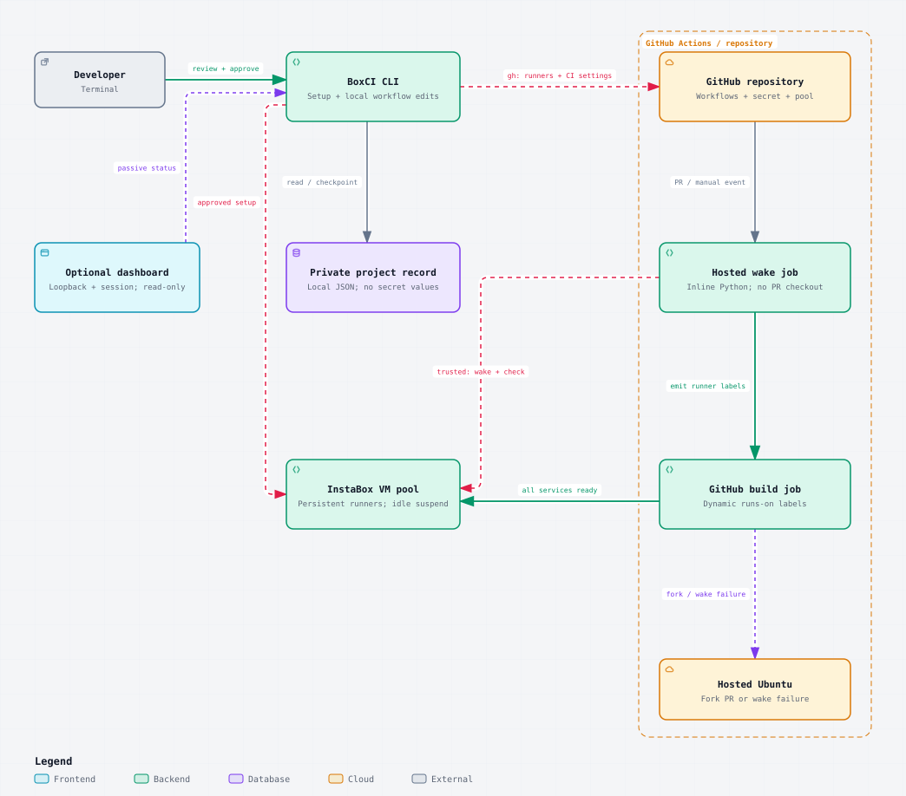

# BoxCI architecture

BoxCI configures a target GitHub repository from a local CLI. After setup, hosted GitHub Actions jobs wake the InstaBox runner pool independently of the CLI or dashboard.



[Open the interactive Archify diagram](architecture/boxci.html) after downloading it, or open that file directly from a local checkout. GitHub displays HTML source rather than executing it. The static SVG above works in repository Markdown without hosting or a diagram service.

## Three paths through the system

- **Setup:** `bin/boxci.js` dispatches commands to `App` in `src/engine.js`; `src/workspace.js` verifies checkout ownership and protects local workflow writes. It reviews a plan, checks identities, quota, VM names and dedicated runner labels, provisions or verifies runners, writes the pool variable and CI secret, and writes only the shared wake helper `.github/workflows/boxci-wake.yml` into the local checkout. It creates no starter or build/test workflow; `migrate` points selected existing jobs at the helper and, if a workflow it changes (or an existing one) calls the helper, creates `.github/workflows/boxci-wake.yml` when it is missing; if a different local copy exists, it stops without changing anything. `init` and `migrate` leave local diffs; users commit and publish through their normal process. Neither command writes remote branches, commits or PRs. Private local JSON records retain recovery checkpoints and credential metadata, without secret values.
- **CI:** `src/workflow.js` and `src/wake.js` write only a shared wake helper during init; migration adds small calls in existing application workflows. The shared `.github/workflows/boxci-wake.yml` reusable workflow containing `ci/wake.py`. A hosted Ubuntu job reads the repository secret and pool manifest. For trusted events, the helper calls the InstaBox HTTP API, wakes reviewed members concurrently and checks their services. It outputs runner labels for GitHub scheduling. Fork PRs and failed or incomplete wakes select hosted Ubuntu. The privileged wake phase never checks out PR code.
- **Monitoring:** the optional dashboard runs in a detached local process by default, managed by `src/dashboard-manager.js` and `src/dashboard-runtime.js`. A separate authenticated local control channel handles process status and shutdown; browser endpoints stay read-only. The browser calls the local authenticated `GET /api/status` endpoint, which uses `App.status`. The engine reads provider state and GitHub runner/job history. These reads do not execute guest commands or resume VMs. The browser polls every 30 seconds while visible; closing it has no effect on hosted CI.

The “GitHub build job” box represents workflow scheduling; its steps execute on the selected InstaBox runner or hosted Ubuntu. The arrow to the VM pool crosses that runtime boundary. Provider reads and setup operations use the official InstaBox CLI or SDK through `src/provider.js`; GitHub operations use `gh` through `src/github.js`. The hosted Python wake helper calls the provider HTTP API directly.

## Source map

| Responsibility                                 | Source                                                                                                                      |
| ---------------------------------------------- | --------------------------------------------------------------------------------------------------------------------------- |
| Command dispatch and reviewed setup/operations | [CLI](../bin/boxci.js), [engine](../src/engine.js)                                                                          |
| Official service adapters and tool bootstrap   | [provider](../src/provider.js), [GitHub](../src/github.js), [tooling](../src/tooling.js)                                    |
| Private local records and recovery locking     | [store](../src/store.js)                                                                                                    |
| Workflow generation, migration and CI routing  | [workflow](../src/workflow.js), [wake YAML](../src/wake.js), [migration](../src/migrate.js), [Python helper](../ci/wake.py) |
| Runner install and legacy pool verification    | [installer](../vendor/install.sh), [identity and paths](../src/brand.js)                                                    |
| Loopback dashboard and browser rendering       | [server](../src/dashboard.js), [client](../web/app.js), [visual tokens](../web/tokens.css)                                  |

Service readiness does not prove GitHub connectivity. Hosted fallback is chosen before assignment and cannot rescue a build already queued on a disconnected self-hosted runner. VMs retain normal idle suspension. There is no always-on BoxCI server, keepalive process or webhook service.

## Updating the diagram

Edit [the diagram source](architecture/boxci.architecture.json) when the architecture changes, then regenerate the HTML with [Archify](https://github.com/tt-a1i/archify). Export the README image with:

```sh
node docs/architecture/export-svg.mjs
```

Review and commit the JSON, HTML and SVG together, along with any source-map changes.

The bundled Archify viewer retains its [MIT license](architecture/LICENSE-Archify.txt). Embedded JetBrains Mono fonts retain their SIL Open Font License notices in the HTML and SVG.
